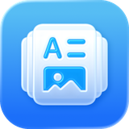
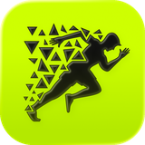
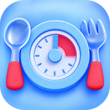
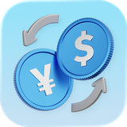

# 👋 Hi, I'm Alex Riakhin

Senior iOS Software Engineer with **5+ years** of professional experience. I build my own apps for iPhone, iPad, Mac and Apple Watch: apps for learning languages, getting stronger and building better habits.

🌐 **[alexriakhin.com](https://alexriakhin.com)** · ✉️ [hello@alexriakhin.com](mailto:hello@alexriakhin.com) · 💼 [LinkedIn](https://www.linkedin.com/in/xander1100001)

## 📱 My apps

  
  
  
  
  
  
  

- **El Recreo** 🆕 · Learn the Spanish they really speak in Buenos Aires, through a story with your new neighbors in Palermo. [App Store](https://apps.apple.com/app/id6761676545) · [Website](https://alexriakhin.com/ElRecreo/)
- **My Dictionary** · Your own dictionary in 180+ languages, with definitions, pictures, spaced review and word games. [App Store](https://apps.apple.com/app/id1588418793) · [Website](https://mydictionary.org)
- **Flippin** · Flashcards you can hear and speak, in 30+ languages. [App Store](https://apps.apple.com/app/id6748499528) · [Website](https://www.flippin.app)
- **Replex** · A gym log for iPhone and Apple Watch, with ready-made plans and an AI coach. [App Store](https://apps.apple.com/app/id6476805884) · [Website](https://alexriakhin.com/Replex/)
- **PureBite** · Intermittent fasting tracker with a Lock Screen timer, Ramadan mode and recipes. [App Store](https://apps.apple.com/app/id6505026086) · [Website](https://alexriakhin.com/PureBite/)
- **Guaraní Converter** · Fast Paraguayan guaraní currency converter for iPhone and Mac. [App Store](https://apps.apple.com/app/id6760961975) · [Website](https://alexriakhin.com/guarani-currency-converter-page/)
- **Price Wizard** · Territory pricing for App Store subscriptions and in-app purchases. [App Store](https://apps.apple.com/app/id6759319356) · [Website](https://alexriakhin.com/PriceWizard/)

🤖 Android versions are on the way, starting with El Recreo.

## 🚀 About me

- 💼 Senior iOS Software Engineer at **KODE**: trading apps, government services and MAPS.ME (5M+ downloads)
- 🛠️ Swift, SwiftUI, UIKit, Combine, Swift Concurrency, MVVM/MVI, WidgetKit, Live Activities, watchOS
- 🤖 AI in my daily workflow: Claude Code, Codex, Cursor, plus LLM features in my own apps
- 🎺 Bachelor of Arts in Trumpet from the Gnessin Russian Academy of Music
- 📍 Based in Brazil
